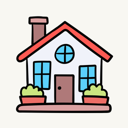
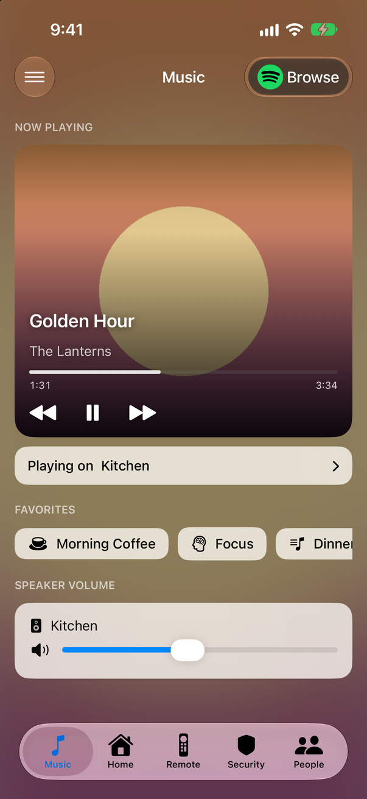
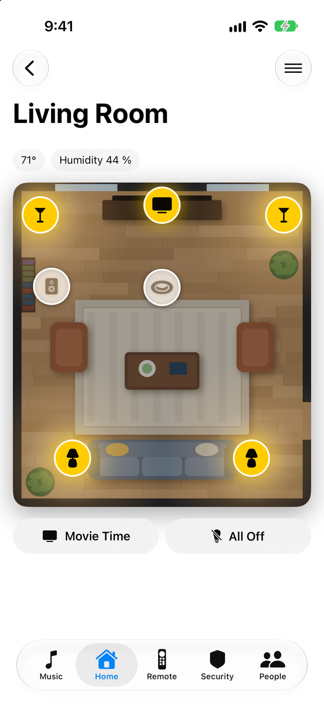
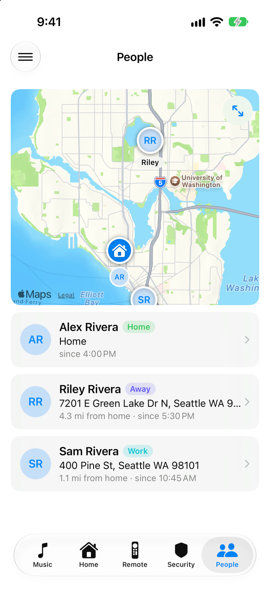
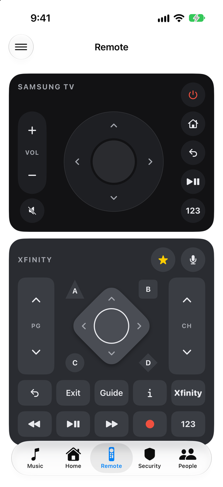
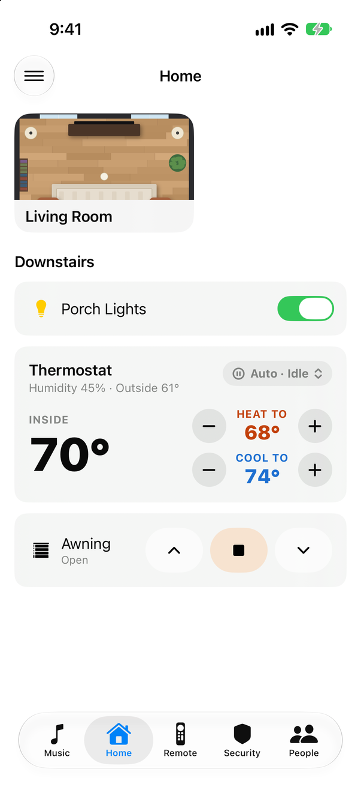
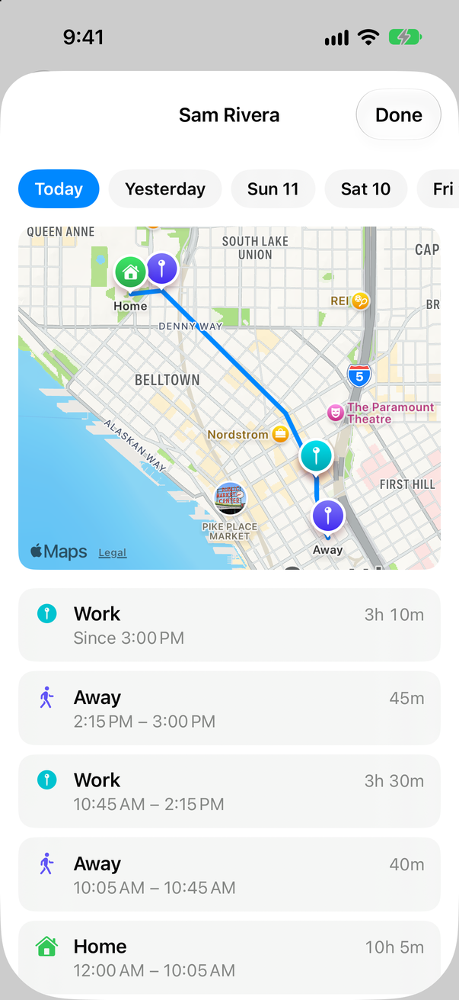
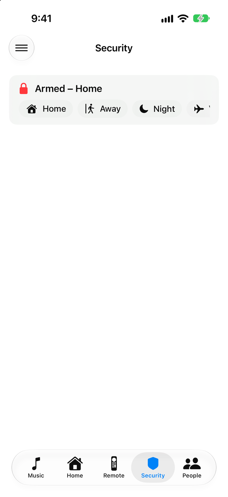

<p align="center">
  
</p>

<h1 align="center">Hassonic</h1>

<p align="center">
  A native iPhone app for <a href="https://www.home-assistant.io/">Home Assistant</a>:<br>
  your music, your rooms and your household, laid out in one YAML file.
</p>

<p align="center">
  <a href="https://github.com/JeffSteinbok/Hassonic-iOS/actions/workflows/build.yml"></a>
  <a href="https://github.com/JeffSteinbok/Hassonic-iOS/actions/workflows/validate-config.yml"></a>
  
  
  <a href="https://www.home-assistant.io/"></a>
  <a href="https://jeffsteinbok.github.io/Hassonic-iOS/"></a>
</p>

<p align="center">
  
  
  
  
</p>

> **Hassonic isn't on the App Store.** You build it yourself with Xcode and
> install it on your own iPhone. It's a personal project shared as source:
> clone it, give it your own app ID, and point it at your Home Assistant.
> The screenshots here come from a made-up demo household.

---

## Contents

- [What it does](#what-it-does)
- [What you need](#what-you-need)
- [Getting started](#getting-started) — build, sign in, add your config
- [Configuration](#configuration)
- [Development](#development) — tests, screenshots, scripts
- [How it's built](#how-its-built)
- [Limitations](#limitations)

---

## What it does

| | |
|---|---|
|  | **Music.** What's playing, your favorites, and every speaker's volume, for each streaming account in the house. Pick which speaker or group plays; a group's volume moves all its speakers together. While music plays, a **Live Activity** on the Lock Screen and in the Dynamic Island shows the zone and lets you switch speakers and change the volume without opening the app. |
|  | **Pages you lay out.** Each tab is a page from your config: lights, covers, thermostats, an alarm panel, TV remotes, people. Rooms show as tiles at the top of the first page. |
|  | **Rooms.** A picture of the room with a button on each device, where it really is. Tap to toggle a light, fan or speaker; hold for brightness, speed or volume. Lights that are on glow on the floor. An oven or fridge shows its temperature on the picture, and a tap opens its modes and setpoint. Chips above show the room's sensors; buttons below set several devices at once. |
|  | **TV remote.** A TV and the box plugged into it, each with its own panel. Keys grey out while the TV is off, and the box's panel dims while the TV is showing one of its own apps. |
|  | **People.** Everyone in the household on one map, with where they are, how far from home and since when. |
|  | **History.** Tap someone to see their day: the path they took on a map, and each place they stayed and for how long. Go back as many days as Home Assistant keeps. |
|  | **Security.** Arm and disarm your alarm, and, with LLM Vision, a timeline of what your cameras saw. |

Everything comes from **one YAML file on your Home Assistant**. Change it, pull
down in the app, and it updates. A mistake in the file doesn't break the app:
it keeps the last good version and tells you which key is wrong.

---

## What you need

| | |
|---|---|
| **Home Assistant** | Reachable from your phone. An external URL (Nabu Casa or your own) works anywhere; an optional internal URL is used on your home Wi-Fi. |
| **An iPhone on iOS 26 or later** | |
| **A Mac with Xcode 26+** and [XcodeGen](https://github.com/yonaskolb/XcodeGen) | To build the app: `brew install xcodegen`. |
| **An Apple Developer Program membership** | To install on a device. The app asks for push notifications, which a free account can't sign. |

Each card only needs its own integration, and a card you don't use needs
nothing:

| Card | Needs |
|---|---|
| Music, Live Activity | A music service whose account entity lists speakers in `source_list` (Spotify Connect is the one tested), and speakers as `media_player` entities (Echo, Sonos, Google, receivers…). Playback uses stock `media_player` services. |
| Moving a speaker between accounts | **Alexa Media Player** (HACS) and Echo devices. Optional; see [Spotify and Alexa](docs/SPOTIFY_AND_ALEXA.md). |
| `light`, `cover`, `alarm`, `thermostat`, `people`, `room` | Entities of those kinds. Rooms take lights, fans, switches, speakers, covers, ovens and fridges (`water_heater`), and sensors. |
| `tv_remote` | **SamsungTV Smart** (HACS) or HA's built-in **Samsung Smart TV**, and for a cable box the [**Xfinity Remote**](https://github.com/JeffSteinbok/hass-xfinityremote) integration. |
| `llm_vision_timeline` | **LLM Vision** (HACS) and an AI provider for it. |

---

## Getting started

### 1. Build it

```bash
git clone https://github.com/JeffSteinbok/Hassonic-iOS.git
cd Hassonic-iOS
xcodegen generate          # makes Hassonic.xcodeproj from project.yml
open Hassonic.xcodeproj
```

Run it in a simulator straight away: with no other settings it builds as
`com.example.Hassonic`.

### 2. Give it your own app ID (to run on your iPhone)

Apple needs every app to have an ID that belongs to you. Make your settings
file and fill it in:

```bash
cp Config/Local.xcconfig.example Config/Local.xcconfig
```

| Setting | What to put |
|---|---|
| `BUNDLE_ID_PREFIX` | Your reverse-domain prefix, e.g. `com.yourname`. The app becomes `com.yourname.Hassonic`. |
| `DEVELOPMENT_TEAM` | Your team ID, from Xcode → Settings → Accounts. |
| `APP_NAME` | Optional. The name under the icon; default **Hassonic**. |
| `CONFIG_NAME` | Optional. The config file's name on Home Assistant; default `hassonic`, for `hassonic.yaml`. |
| `APP_BUNDLE_ID` | Optional. A whole app ID, to keep an app you already have in App Store Connect. |
| `HA_OAUTH_CLIENT_ID` | Optional. The sign-in page (below); defaults to this repo's. |

`Config/Local.xcconfig` is gitignored, so it stays yours. Run
`xcodegen generate` again, pick your iPhone in Xcode, and press Run.

Debug builds install as a separate **Hassonic Dev** app, with a DEV badge on
its icon, so you can try changes without replacing the version you use.

### 3. Sign in

Open the app, tap **Get Started**, enter your Home Assistant URL and tap
**Log in with Home Assistant**. You sign in on your own server's page; the app
keeps the tokens in the iOS Keychain and renews them itself.

During sign-in, Home Assistant checks a small public page that names the
app's return address, `hassonic://auth-callback`. That page is
[`docs/index.html`](docs/index.html), served at
[jeffsteinbok.github.io/Hassonic-iOS](https://jeffsteinbok.github.io/Hassonic-iOS/).
It holds no data. If you'd rather not depend on it, publish your own copy and
set `HA_OAUTH_CLIENT_ID`.

### 4. Add your config

The app shows nothing of yours until it has a config file:

1. Open your Home Assistant config folder: the **File editor** or **Studio
   Code Server** add-on, the **Samba share** add-on, or SSH.
2. Make a `www` folder next to `configuration.yaml` if there isn't one, and
   **restart Home Assistant** if you just made it. It only serves folders that
   existed when it started.
3. Create `www/hassonic.yaml`. Start from [`Hassonic/Config.yaml`](Hassonic/Config.yaml)
   or the [example in the configuration guide](docs/configuration.md), with
   your own entity IDs (Settings → Devices & services → Entities).
4. Check that `https://<your-home-assistant>/local/hassonic.yaml` opens in a
   browser, then pull down on any page in the app.

---

## Configuration

[**The configuration guide**](docs/configuration.md) covers every card type
and option. A small example:

```yaml
version: 1
pages:
  - id: home
    title: Home
    system_icon: house.fill
    sections:
      - title: Downstairs
        cards:
          - type: light
            entity: light.porch_lights
          - type: thermostat
            entity: climate.thermostat

  - id: living_room          # a room: a tile on the first page
    title: Living Room
    system_icon: sofa.fill
    room: true
    sections:
      - cards:
          - type: room
            image: /local/living_room.png    # in your www folder
            hotspots:
              - { entity: light.floor_lamp, icon: torchiere, x: 0.09, y: 0.10 }
              - { entity: media_player.living_room_tv, icon: tv.fill, x: 0.50, y: 0.07 }
```

Hotspot `x` and `y` are where the device sits in the picture, as a fraction
of its width and height.

To check a file before Home Assistant serves it:

```bash
scripts/validate_config.sh hassonic.yaml
```

More: [Spotify and Alexa](docs/SPOTIFY_AND_ALEXA.md) ·
[Assistant and device pairing](docs/assistant.md) ·
[Live Activity](docs/live-activity.md) ·
[Push notifications](docs/push-notification-setup.md)

---

## Development

### Tests

```bash
xcodegen generate
xcodebuild test -project Hassonic.xcodeproj -scheme Hassonic \
  -destination 'platform=iOS Simulator,name=iPhone 17 Pro' \
  -only-testing:HassonicTests
```

The tests need no Home Assistant: `MockHAClient` stands in for the
connection, and JSON fixtures in `HassonicTests/Fixtures/` stand in for its
messages. Every pull request builds the app and runs them; `main` only
accepts a pull request once they pass.

### Screenshots

```bash
scripts/screenshots.py
```

Builds the app, loads the made-up household in [`Demo/`](Demo) into a
simulator, and captures each screen into `docs/images/`. Debug simulator
builds have a demo mode for this, so no real home ever ends up in a
screenshot.

### Scripts

| Script | What it does |
|---|---|
| `scripts/validate_config.sh <file>` | Checks a config with the app's own parser. |
| `scripts/deploy_config.py <file>` | Validates a config and copies it to Home Assistant (`--via ssh` or `--via copy`), then checks it's served. Needs `HA_URL` in `.ha.env`. |
| `scripts/inject_config.py <file>` | Loads a config into the app in a booted simulator, without Home Assistant. |
| `scripts/export_ha_entities.py` | Writes a sanitized list of your Home Assistant's entities to `docs/home-assistant-entities.json` (gitignored), handy when writing a config. |
| `scripts/ha_music_flow.py` | Runs the app's speaker-switching flow against your Home Assistant from the command line. |
| `scripts/add_app_icon.py` | Adds an alternate app icon to the in-app picker. |
| `scripts/screenshots.py` | Retakes the README screenshots. |
| `scripts/testflight.sh` | Archives a Release build and uploads it to TestFlight with your `Local.xcconfig`. |

---

## How it's built

```
HassonicApp                  entry point: welcome, splash, tabs, or connection failed
├── HAWebSocketClient        the connection and every entity's state; service calls
├── AppConfigurationLoader   fetches and checks your YAML; keeps the last good one
├── AppRouter                tabs, rooms, links (hassonic://<page>), sheets
├── MusicZonesView           the Music tab
├── DashboardPageView        a page from the config, and its cards
├── RoomPlanCardView         a room: picture, hotspots, device controls
├── PeopleCardView           the People card, and each person's history
└── ZonesLiveActivityController   the Live Activity

HassonicWidgets              the Live Activity's Lock Screen and Dynamic Island views
Shared/                      what the app and the widget both compile
```

The Xcode project is generated from `project.yml` with XcodeGen and isn't
committed. Libraries: [Yams](https://github.com/jpsim/Yams) for YAML, and
[Firebase](https://github.com/firebase/firebase-ios-sdk) for push
notifications, which stay off until you add your own
`GoogleService-Info.plist`.

---

## Limitations

- One Home Assistant server at a time.
- The config is edited on the server, not in the app.
- The Live Activity updates while the app is running; see
  [Live Activity](docs/live-activity.md) for push-based options.

---

## Contributing

Issues and focused pull requests are welcome. Build and run the tests before
opening one, and never commit tokens, server addresses or anything else from
your own home.
