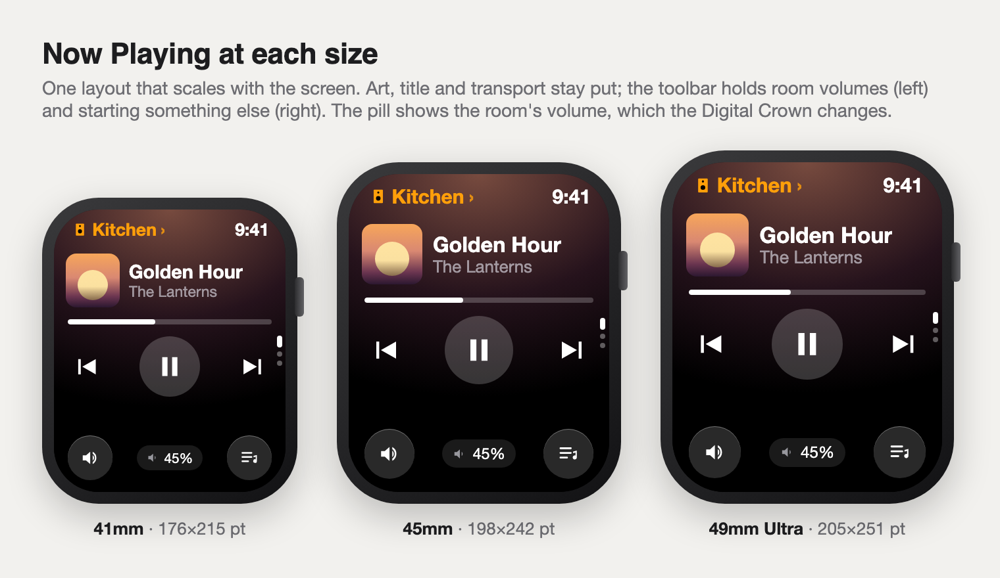
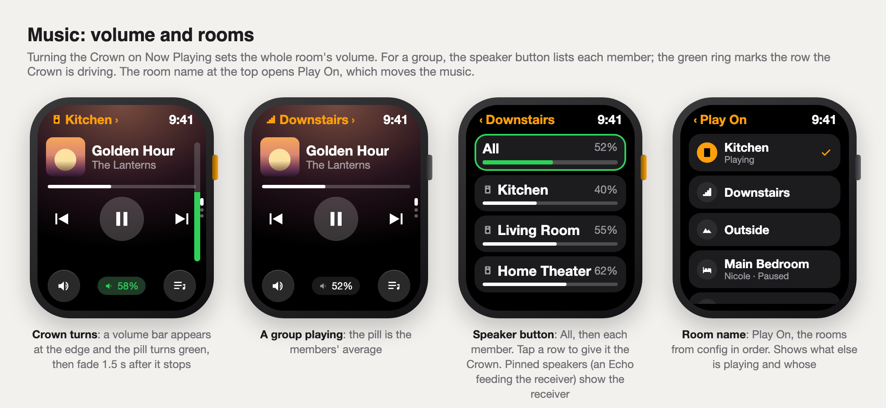
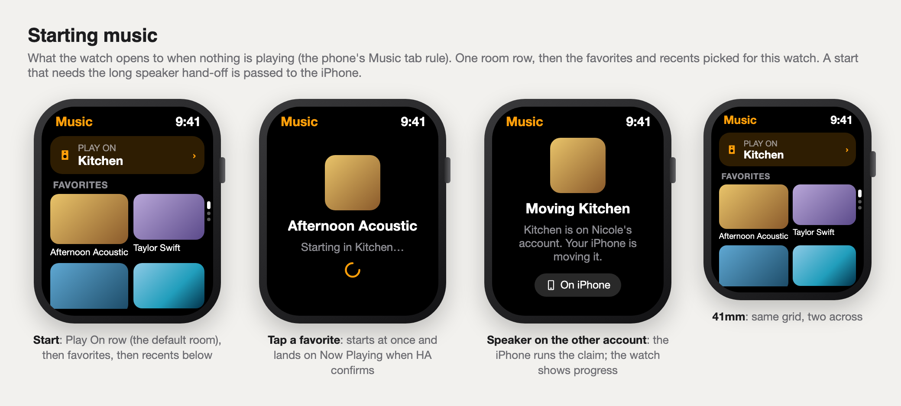
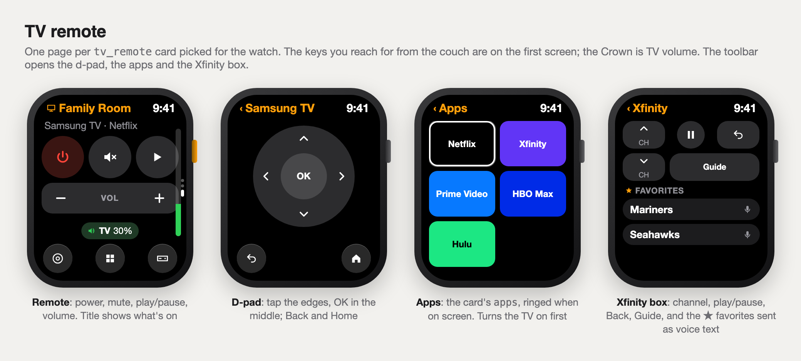
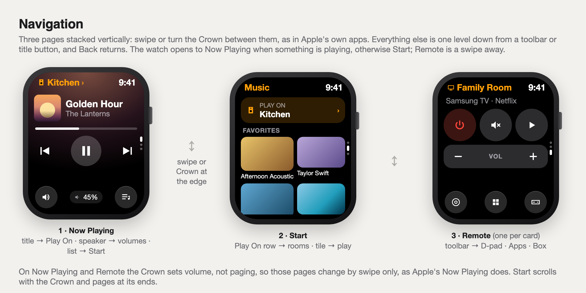
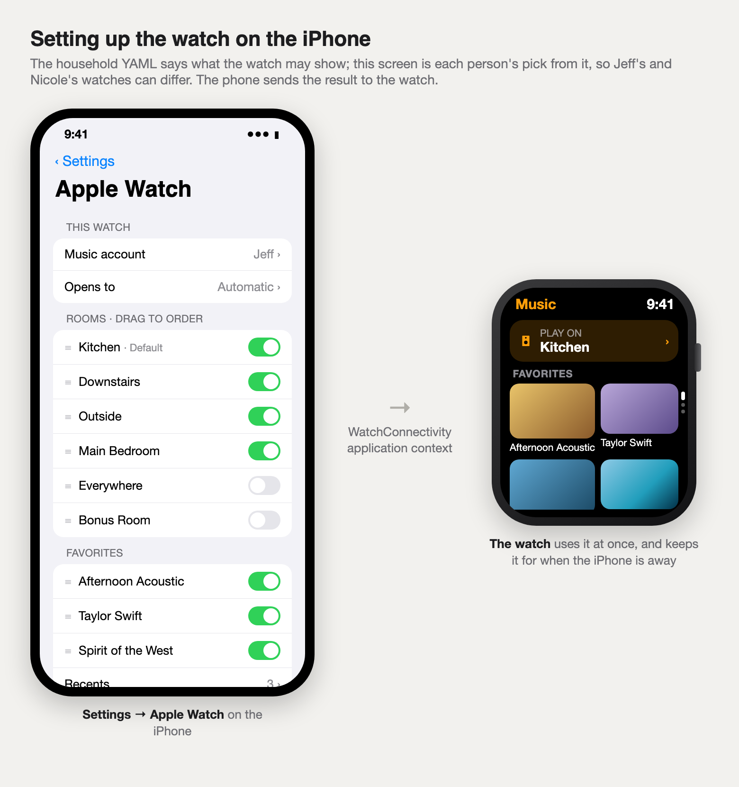
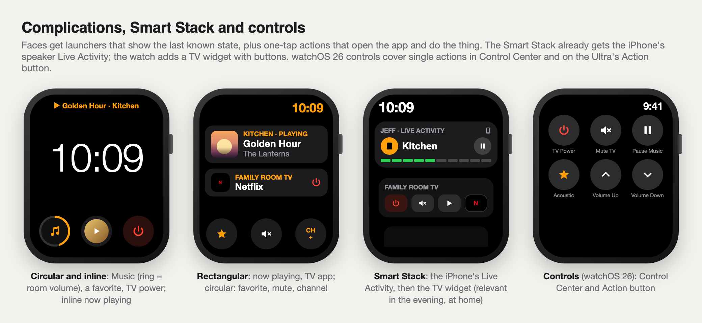

# Apple Watch app: plan and design

Status: proposal. Nothing here is built yet. This doc covers what the watch app
does, how it's set up, and how it's built. It reuses as much of the iPhone app as
it can.

The mockups are HTML drawn at real watch sizes from `steinbokhome.yaml`'s rooms,
favorites and remote. No Watch simulator is paired with the StartMusic iPhone,
so nothing here is a real SwiftUI preview yet. Their source is
[`mockups.html`](mockups.html), and [`render.sh`](render.sh) renders it back to
the PNGs.

## Summary

- **What it's for:** music and the TV remote, for things that take a few
  seconds. You check what's playing and where, pause, skip, use the Crown for
  volume, start a favorite in a room, and use the TV's power, volume, mute and
  apps. Everything else stays on the phone.
- **Shape:** three pages stacked vertically: **Now Playing**, **Start** and
  **Remote**. It opens on Now Playing when something is playing and on Start
  when nothing is, which is the same rule as the phone's Music tab.
- **Config:** the household YAML gets an optional `watch:` section that says
  what a watch *may* show. Each person then picks from it on their iPhone
  (Settings → Apple Watch). The phone combines the two into one small JSON
  snapshot and sends it to the watch with WatchConnectivity. On the watch, the
  app and its widgets share that snapshot through an App Group.
- **Architecture:** the watch talks to Home Assistant **itself** over HTTPS:
  the REST API, then the websocket if watchOS allows it (a spike settles this).
  That way it works when the phone is out of reach. The phone hands over sign-in
  and config, and also takes on the long jobs the watch can't finish with the
  wrist down: claiming a speaker that's on another account, and putting volumes
  back after a start.
- **MVP:** Now Playing with Crown volume (group volume included), switching
  rooms, four favorites, and one complication. That's about 2 weeks, after a
  2–3 day spike.

## 1. Use cases, and what not to do on a wrist

The watch is for moments when the phone is in a pocket, on the counter, or in
another room.

| Moment | What the watch does |
|---|---|
| Doorbell, phone call, someone talking | Pause the music, or mute the TV. One tap from the face. |
| Cooking with messy hands | Turn the kitchen up with the Crown. Skip a track. |
| Walking out to the patio | Move the music to Outside, or to Downstairs and Outside. |
| Starting dinner | Play Afternoon Acoustic in the Kitchen. One tap from a complication. |
| On the couch, remote lost | TV power, volume, mute, play/pause, Netflix. Box channel up/down and the ★ favorites ("watch the Mariners"). |
| Bedtime | Turn the TV off. Stop the music everywhere. |
| "What's playing upstairs?" | Glance at the room and the other rooms in Play On. |

**What not to put on the watch.** Each of these is something the phone already
does better:

- **Browsing the music library**, search, or the Spotify media browser. The
  watch offers only favorites, recents and Resume.
- **Typing anything.** No number pad, no channel numbers.
- **The voice key on the Xfinity box.** The ★ favorites cover the common
  phrases. Dictation could be added later, but it's slow and error-prone on a
  wrist.
- **The rest of the Xfinity keypad**: A–D, Page, Info, Exit, Record, Menu.
- **Room pictures, lights, thermostat, security, people.** They're out of scope
  for now. The architecture doesn't stop them being added later (§5).
- **Editing settings on the watch.** All setup happens on the phone (§3).
- **Spinners that need the wrist up.** Anything that takes longer than a couple
  of seconds is handed to the phone or finished in Home Assistant. The watch
  never waits out a 16-second voice round trip (§5.5).
- **A second "now playing" in the Smart Stack while music plays.** The iPhone's
  speaker Live Activity is already there (§4).

## 2. Screens

### Now Playing



The layout matches the phone's square Now Playing card (#16), scaled down: art,
title and artist, a progress bar, and previous, play/pause and next. The
background is tinted from the art.

- **The title is the room** ("Kitchen ›"). Tapping it opens Play On.
- **The Digital Crown sets the room's volume.** Each detent changes it by 2%.
  The UI moves immediately, and the watch sends at most one `volume_set` every
  250 ms, plus the final value when the Crown stops. This is the phone's slider
  behavior, using the same entities: `StartVolume.targets(for:zones:)` already
  works out which speakers a zone's volume really drives. It skips proxies and
  speakers pinned with `defaultVolume`, and the Home Theater Echo drives the
  Pioneer receiver. A move by hand also calls
  `StartVolumeGuard.userChangedVolume()`, so a restore after a start doesn't
  undo it.
- **The toolbar** has the speaker button (room volumes) on the left, a volume
  pill in the middle, and Start on the right.
- **Which account:** the watch's account, set per watch (§3). If it differs
  from the phone's Music tab, the phone's choice doesn't affect the watch.



- **Group volume.** When a group is playing (Downstairs, Everywhere), the Crown
  moves every member together, keeping their offsets, and the pill shows the
  average. The speaker button lists **All** and then each member. Tap a row to
  give it the Crown; the green ring shows which row has it. This is the
  phone's speaker-volume list, adapted to the Crown.
- **Play On** lists the rooms picked for this watch, in their order. It also
  shows what else is playing and whose, using `MusicTabLayout.otherPlaying`.
  Picking a room moves the music with `select_source`, the same path as the
  phone's Play On sheet. If the room is on the other account, see §5.5.

### Start



Start is the watch's version of the phone's start layout (#19).

- A **Play On** row at the top shows the default room: the watch's chosen
  default, else where the account last played (`MusicTabLayout.defaultTarget`).
- **Resume** appears when the account has something loaded.
- **Favorites**, then **Recents**: two across, art first, scrolled with the
  Crown.
- Tapping a tile starts it right away. The tile shows "Starting in Kitchen…" and
  the app moves to Now Playing once Home Assistant reports it playing, using
  `MusicStart.hasStarted`.
- Recents come from the phone. It sends the top few of `RecentMusicStore` in the
  snapshot (§3), art paths included, because the watch can't browse the media
  library cheaply.

### TV remote



The watch shows one Remote page for each `tv_remote` card picked for it. Today
that's Family Room. Every key goes through the code the phone already uses: the
card's `actions(for:on:)` and `TVRemoteAction`. So `power: script…` (the
Broadlink IR toggle), the Samsung play/pause rule, and opening an app (turn on,
wait, then `select_source`) all behave the same on both devices.

- **First screen:** power, mute, play/pause, volume −/+. The title shows what's
  on ("Samsung TV · Netflix").
- **The Crown is TV volume.** Samsung TVs only step volume by key presses, so
  each detent sends one `KEY_VOLUP`/`KEY_VOLDOWN`, and the watch caps it at
  about 6 per second so commands don't pile up. If the card's `mediaPlayer`
  supports `volume_set`, the Crown uses that instead.
- **The toolbar** has the D-pad, the Apps and the Box.
  - **D-pad:** tap the edges, OK in the middle, Back and Home. The watch
    vibrates once for each key sent. The d-pad is worth it on the watch for
    TV menus ("are you still watching?"), but it's a page down, never the
    first screen.
  - **Apps:** the card's `apps`, colored tiles with the app on screen ringed.
    Logos come later; they need the image cached on the watch.
  - **Xfinity box:** channel up/down, play/pause, Back, Guide, and the ★
    favorites, which are sent as text with `xfinity_remote.send_text`. A box
    favorite works the same on the watch as on the phone.
- The box screen is disabled when the phone's rule disables the box panel: TV
  off, an app on screen, or Home Assistant disconnected. The reason is shown
  as a caption.
- Keys are chosen per watch with the same names `lockScreen` uses: `tv.power`,
  `box.playPause`, `app.Netflix` (§3).

### Navigation



- The **three pages are stacked vertically**: Now Playing, Start, Remote, then
  any more remotes. This is the watchOS 10+ pattern (a vertical page
  `TabView`).
- **Everything else is one level down**, opened from a title or toolbar button,
  and Back returns. There are no nested pagers.
- **Which page it opens on:**
  - Opening the app: Now Playing if the account has media, otherwise Start
    (`MusicTabLayout.wanted`).
  - A complication or widget opens the page it names.
  - "Opens to" can pin Music or Remote per watch.
- **The Crown sets volume on Now Playing and Remote**, so those pages change by
  swipe only. Apple's Now Playing works the same way. Start scrolls with the
  Crown.

## 3. Configuration

### What can be configured

| Setting | Household YAML (`watch:`) | Per watch (iPhone) | Default if unset |
|---|---|---|---|
| Music account | allowed accounts | **which one** | the phone's selected account |
| Rooms shown, in order | list and order | hide/show, reorder | `liveActivityZones`, then castable zones, groups first |
| Default room | — | **pick** | where the account last played |
| Favorites shown, in order | list and order | hide/show, reorder | the account's first 4 favorites |
| Recents | max count | count (0–5) | 3 |
| Remotes shown | which `tv_remote` cards | hide/show | all, in page order |
| Remote keys, per card | first-screen keys, `dpad`, `apps`, `box` | — | power, mute, play/pause, volume; all subpages |
| Opens to | — | Automatic / Music / Remote | Automatic |
| Complication choices | candidate favorites, rooms, keys | — (picked on the face) | first favorite, default room, `tv.power` |

### Where it lives: both, split by who decides

**Household YAML.** An optional `watch:` section in `hassonic.yaml`
(`steinbokhome.yaml`) sets what the house offers. It names entities and keys
that already exist elsewhere in the file. The app and `validate_config.sh`
already ignore keys they don't know, so adding it breaks nothing.

```yaml
watch:
  music:
    rooms:                       # order shown; ids from media.accounts[].speakers/groups
      - media_player.alexa_kitchen
      - media_player.downstairs_2
      - media_player.alexa_outside
      - media_player.main_bedroom
      - media_player.everywhere
    favorites: [Afternoon Acoustic, Taylor Swift, Spirit of the West]   # displayName or contentId
    recents: 3
  remotes:
    - card: Family Room          # a tv_remote card's title
      keys: [tv.power, tv.mute, tv.playPause, tv.volume]   # lockScreen names, plus tv.volume for −/+
      dpad: tv                   # tv | box | none
      apps: [Netflix, Xfinity, Hulu]
      box: true                  # the Xfinity page with its ★ favorites
  complications:
    favorites: [Afternoon Acoustic]
    keys: [tv.power, tv.mute, box.playPause, app.Netflix]
```

**Per watch, on the iPhone.** Each person picks from what the house offers:
whose account it is, the default room, what's hidden, the order, and what it
opens to. This is what lets Jeff's watch play Jeff's Spotify and Nicole's play
Nicole's from the same file. The YAML can't express "this person's watch".



The picks are stored in the phone's `UserDefaults`, which is in practice one
person and one watch. The YAML is the list of choices and the phone is the
choice. If the YAML later drops a room, the pick for it is ignored instead of
being an error, the same way `liveActivityZones` handles a room that's gone.

### How it syncs: WatchConnectivity, then an App Group on the watch

App Groups don't cross devices, so the phone has to send the data.

1. **The phone builds a `WatchSnapshot`.** It's Codable JSON of a few KB. It
   combines the `watch:` section, the per-watch picks, and the parts of the
   config those point at: the account's entity, the zones (name, icon,
   `sourceName`, members, proxy, pinned volume), the chosen favorites, the
   top recents, and each remote's resolved `TVRemoteAction`s per key. The
   watch never parses YAML and never needs Yams.
2. **The phone sends it with `WCSession.updateApplicationContext`.** It does
   this when the config refreshes, when a pick changes, and when a recent is
   recorded. The system delivers only the latest snapshot, even if the watch
   was asleep, which is exactly right for config.
3. **The watch writes it to an App Group container** (`group.<APP_BUNDLE_ID>`)
   shared by the watch app and its widget extension. Then it calls
   `WidgetCenter.reloadAllTimelines()`.

Two alternatives were rejected:

- The watch fetching `/local/hassonic.yaml` itself would need Yams and the
  whole schema on the watch, and still couldn't know the per-watch picks.
- iCloud key-value storage is shared by every device on the Apple ID, so it
  can't hold per-watch picks. Its timing isn't reliable either.

## 4. Complications, widgets and controls



All of these are one watchOS WidgetKit extension. The widgets read the
`WatchSnapshot` and a small "last known state" from the App Group. Each
configurable widget uses `AppIntentConfiguration` with `recommendations()`.
That's how a watch face offers "Afternoon Acoustic", "Kitchen" or "TV Power" as
choices, and the list comes from the snapshot's `complications:` candidates.

| Widget | Families | Tap | Shows |
|---|---|---|---|
| **Music** (MVP) | circular, corner, inline | opens Now Playing | Room, play state, volume ring, all last known. Inline: "▶ Golden Hour · Kitchen". |
| **Favorite** | circular, corner | opens the app and starts it in the default room (deep link) | The favorite's art or icon |
| **Now Playing** | rectangular | opens Now Playing | Art, room, title (last known) |
| **TV** | rectangular (Smart Stack), circular | rectangular: buttons run App Intents in place; circular: one key | What's on, plus power, mute, play/pause and one app |
| **Controls** (watchOS 26) | Control Center, Smart Stack, Action button on Ultra | runs the intent | TV Power, Mute TV, Pause Music, Volume ±, a favorite |

**Smart Stack relevance.**

- **Music:** the iPhone's speaker Live Activity already appears in the watch's
  Smart Stack while music plays (#10). So the watch doesn't add a competing
  Now Playing widget for that time. One cheap phone-side change makes that
  card better: add `.supplementalActivityFamilies([.small])` to
  `ZonesLiveActivity` and draw a layout for the watch, with the room, play/pause
  and the volume segments. Today the watch shows the generic compact view.
- **TV widget:** relevant in the evening and at home, using watchOS 26
  relevance (`RelevanceConfiguration` with date and location contexts). It's
  also relevant while the TV's `media_player` is on, as far as the watch last
  knew.
- **Favorite widget:** relevant at the times you usually start that favorite.
  This comes later and needs history.

**Refresh budget.** Face complications get roughly 50 timeline reloads a day,
and the system decides when they happen. So complications show **last known**
state and never claim to be live:

- The watch app reloads them whenever it's open and something changes, which is
  free while it's running.
- The phone can push an update with `transferCurrentComplicationUserInfo`.
  This is limited to about 50 a day, and it wakes the watch app in the
  background to reload. The phone sends one when the Live Activity controller
  sees play/stop or a room change, but no more than once every 10 minutes, so
  the budget lasts the day.
- Timelines use `.after(15 minutes)` as a backstop. When the last-known state
  is older than an hour, the complication drops to a plain glyph instead of
  showing a stale track.

## 5. Architecture

### 5.1 Independent, with the phone as helper

The watch app is a **watch-only target embedded in the iPhone app**. It installs
with the phone app, so `WKRunsIndependentlyOfCompanionApp = NO`. At runtime it
**reaches Home Assistant directly**, over Wi-Fi, over the phone's Bluetooth
connection, or over cellular, so taps keep working when the phone is in another
room or dead.

The phone does three things:

1. Hands over sign-in and URLs.
2. Sends the config snapshot.
3. Runs the long jobs (§5.5).

A phone-dependent design, where every tap is relayed through the phone with
`sendMessage`, was rejected. It fails exactly when the phone is out of range,
and it would wake the iPhone app for every Crown detent.

### 5.2 Reaching Home Assistant at home and away

The phone already stores an internal URL, an external URL (Nabu Casa or a
remote URL) and a trusted SSID (`ConnectionURLResolver`). The snapshot carries
both URLs.

**The watch can't read the Wi-Fi name**; `NEHotspotNetwork` isn't on watchOS.
So the watch:

1. Tries the internal URL first with a **1-second** timeout, then the external
   one.
2. Remembers which worked, and tries that one first next time.
3. Retries the other on the next failure.

A request that goes over the phone's Bluetooth proxy adds roughly 100–300 ms.
The Crown's optimistic UI hides that.

### 5.3 Sign-in and tokens

The phone holds an OAuth access token and refresh token (`HAOAuthClient`,
`KeychainStore`). The watch has its own bundle ID and its own Keychain, so
nothing is shared automatically.

- **Handover:** once the phone is signed in, and again after a re-login, it
  sends `{refreshToken, externalURL, internalURL}` with
  `WCSession.transferUserInfo`. That call is queued and guaranteed to arrive.
  The watch stores the values in **its own Keychain** and refreshes access
  tokens itself with the same refresh-token request (`/auth/token`) the phone
  uses. Home Assistant allows several access tokens from one refresh token.
- **Sign-out** on the phone sends a "forget" message. The watch deletes its
  Keychain items and shows "Sign in on your iPhone".
- **Rejected:**
  - iCloud Keychain sync (`kSecAttrSynchronizable`) syncs to every device on
    the Apple ID, and its timing is unreliable.
  - A sign-in flow on the watch: there's no `ASWebAuthenticationSession`
    there worth using.
  - A long-lived token typed in by hand.

### 5.4 Live state, and the battery

**Platform risk:** Apple's TN3135 restricts low-level networking on watchOS.
That includes `URLSessionWebSocketTask`, which is allowed only in specific
cases such as an active audio session. Ordinary `URLSession` HTTP is always
allowed. Phase 0 checks this on a real watch. The plan doesn't depend on the
websocket:

- **While the app is on screen:** a short poll of the REST API.
  - One `POST /api/template` per tick returns, as JSON, the states the screen
    needs: the account, the active zone's volume entities, and the TV's
    `media_player`.
  - It ticks every 2 s while the wrist is up, plus an immediate tick after each
    command.
  - It stops when the screen dims (`isLuminanceReduced`) or the app goes
    inactive.
  - If the websocket turns out to work, the same `HAEntityState` model can be
    fed by `subscribe_events` instead, with no change to the views.
- **While the app isn't on screen:** no networking at all. Complications show
  last known state (§4), and the iPhone's Live Activity covers live music.
- **Battery:** polling happens only while you're looking at the app, which is
  a few seconds at a time. No background refresh is booked for state.

### 5.5 Short jobs on the watch, long ones on the phone

Some flows take longer than someone will keep their wrist up:

- **Claiming a speaker from another account:** `claimSpeaker`, a voice
  round trip of up to about 16 s.
- **Putting volumes back after a start:** `StartVolumeGuard`, several seconds.

The phone already runs both from the background for Siri
(`PlayOnSpeakerIntent` → `MusicIntents.play`).

- **Phone reachable:** the watch sends `{favoriteId, zoneId, accountId}` with
  `WCSession.sendMessage`, which wakes the iPhone app in the background. The
  phone runs `MusicIntents.play` and replies with the result. The watch shows
  progress ("Your iPhone is moving it") and Now Playing once it's playing.
- **Phone not reachable:** the watch does the simple path itself:
  1. `select_source` with confirmation.
  2. `play_media`.
  3. A best-effort volume restore: it saves the levels from before the start
     and sets them back once, if the screen is still on.

  If the zone is on the other account, it says so ("Kitchen is on Nicole's
  account. Open Hassonic on your iPhone to move it.") instead of trying.

### 5.6 App Intents on the watch

Intents run in whichever process owns them, so the watch app needs its own:

- `PlayFavoriteIntent` (favorite, room)
- `SetPlaybackIntent` (play, pause, next)
- `SetRoomVolumeIntent` (up, down, or a level)
- `PressRemoteKeyIntent` (card, key)
- `OpenTVAppIntent` (app)

These back:

- the TV widget's buttons,
- the watchOS 26 controls and the Ultra's Action button,
- Siri on the watch ("Play Afternoon Acoustic in the Kitchen with Hassonic"),
  through a watch `AppShortcutsProvider`.

The entity types (`SpeakerEntity`, `FavoriteEntity`, `TVAppEntity`) move into
shared code and read the snapshot on the watch instead of
`AppConfigurationLoader`. The iPhone keeps its own `HassonicShortcuts`.

### 5.7 Sharing code

The repo already shares code by folder: `Shared/` is compiled into both the app
and the widget extension. The plan does the same with a new `Core/` folder,
compiled into the iPhone app, the watch app and the watch widgets. That's
simpler than a Swift package with XcodeGen, and the existing `HassonicTests`
cover it with no new test target.

Moving into `Core/` (data and rules only, with no UIKit, ActivityKit or
websocket code):

- `HAModels` (`HAEntityState`, attribute helpers)
- `MusicZone`, `MediaAccount`, `MusicFavorite`; `RecentMusicItem` and the
  `RecentMusic` rules
- `StartVolume` (the rules, not the guard's timing), and the `MusicTabLayout`
  rules
- `TVRemoteKey`, `TVRemoteSide`, `TVRemoteAction`, and the key-to-action
  mapping; `LockScreenKey` parsing
- `WatchSnapshot` (new) and its builder, which runs only on the phone
- `HAServiceCaller` (new), a small protocol: `call(domain, service, data)` and
  `states(ids)`. The phone's `HAWebSocketClient` conforms to it; the watch gets
  `HARESTClient` (new, `URLSession`). `HAOAuthClient`'s refresh request moves
  with it.

Watch-only code: the SwiftUI screens, the poller, the URL picker, the
WatchConnectivity receiver, the intents and the widgets.

iPhone-only code to add:

- `WatchBridge`: the `WCSession` delegate, the snapshot sender and the
  `sendMessage` handler.
- Settings → Apple Watch.
- The `.supplementalActivityFamilies([.small])` layout for the Live Activity.

### 5.8 `project.yml`, signing and CI

```yaml
options:
  deploymentTarget: { iOS: "26.0", watchOS: "26.0" }
targets:
  Hassonic:
    dependencies:
      - target: HassonicWatch            # embedded in Watch/
  HassonicWatch:
    type: application
    platform: watchOS
    sources: [HassonicWatch, Core]
    settings:
      base:
        PRODUCT_BUNDLE_IDENTIFIER: $(APP_BUNDLE_ID).watchkitapp
        INFOPLIST_KEY_WKCompanionAppBundleIdentifier: $(APP_BUNDLE_ID)
        INFOPLIST_KEY_WKRunsIndependentlyOfCompanionApp: NO
        CODE_SIGN_ENTITLEMENTS: HassonicWatch/HassonicWatch.entitlements   # app group
      configs:
        Debug:
          PRODUCT_BUNDLE_IDENTIFIER: $(APP_BUNDLE_ID).dev.watchkitapp
          INFOPLIST_KEY_WKCompanionAppBundleIdentifier: $(APP_BUNDLE_ID).dev
    dependencies:
      - target: HassonicWatchWidgets
  HassonicWatchWidgets:
    type: app-extension
    platform: watchOS
    sources: [HassonicWatchWidgets, Core]
    # bundle ID $(APP_BUNDLE_ID).watchkitapp.Widgets, same app group
```

- **The App Group** `group.$(APP_BUNDLE_ID)` (`.dev` for Debug) has to be
  registered in the developer portal. The iPhone app doesn't need it; the
  phone talks to the watch over WatchConnectivity.
- **`scripts/testflight.sh`:** the archive picks up the embedded watch app on
  its own. The build stamp has to be applied to the watch targets too, because
  App Store Connect rejects mismatched versions. Bundle versions already sit at
  project level.
- **CI** (`.github/workflows/build.yml`) gets one step:
  `xcodebuild build -scheme HassonicWatch -destination 'generic/platform=watchOS Simulator'`.
  It needs only the watchOS SDK that ships with Xcode, not a runtime. The rules
  in `Core/` are unit-tested by the existing `HassonicTests` run, and new tests
  cover `WatchSnapshot` building and the `watch:` validation.
  `scripts/config-validator` learns the `watch:` schema (unknown room or key
  names become warnings).
- **Demo mode:** a `WatchSnapshot` fixture plus canned states, like the phone's
  `DemoMode`, so screenshots and previews don't need Home Assistant.

## 6. Phased build plan

Sizes assume one person who knows the codebase. S ≈ 1–2 days, M ≈ 3–5 days,
L ≈ 1–2 weeks.

| Phase | Scope | Size |
|---|---|---|
| **0. Spike and quick win** | On a real watch: check whether `URLSessionWebSocketTask` connects to HA (TN3135); measure REST round trips on internal and external URLs and over the phone's Bluetooth; check a `transferUserInfo` token handover. Separately, ship the `.small` Live Activity layout, which is phone-only and improves the watch today. | S |
| **1. MVP** | `Core/` extraction; `HARESTClient` and the URL picker; token handover and sign-out; `WatchSnapshot` v1 (account, rooms, first 4 favorites; no YAML `watch:` yet); **Now Playing** with transport, **Crown volume**, group volume and Play On; a favorites list on Start; **one complication** (Music: circular, corner, inline; opens Now Playing); CI build step; demo mode. | L (≈2 wk) |
| **2. Configurable music** | The `watch:` YAML section, validator and docs; Settings → Apple Watch on the phone; Recents in the snapshot; Resume; delegating claim and volume restore to the phone (§5.5); the Favorite complication and its recommendations. | M–L |
| **3. TV remote** | Remote page per card: keys, Crown TV volume, d-pad, apps, Xfinity box with ★ favorites; the box-disabled rule; per-card key config. | M |
| **4. Widgets, controls, Siri** | Watch App Intents; TV Smart Stack widget with buttons and relevance; Now Playing rectangular; watchOS 26 controls and the Action button; phone → watch complication pushes, rate limited. | M |
| **5. Polish** | Always-on (dimmed) layouts; haptics; app logos on Apps; screenshots and docs; TestFlight with the watch app. | S–M |

**Recommended MVP (phase 1):** the watch opens on Now Playing for the
account's active room. It has play/pause and skip, the Crown sets volume (all
members together for a group, or one member from the speaker list), the room
title moves the music, and Start offers four favorites. One Music complication
shows the last known room and play state, and opens the app. It needs the
phone only for sign-in and config.

### Risks

- **Websocket blocked on watchOS.** This is likely. The fallback is REST
  polling, which is already the default above. The cost is a 2-second delay
  before seeing changes made elsewhere, which doesn't affect your own taps.
- **Latency on the Crown.** HTTP over the phone's Bluetooth proxy can feel
  slow. The fixes are optimistic UI, sending at most every 250 ms, and the
  internal URL first. If it's still bad, volume moves in bigger steps.
- **Refresh token shared between phone and watch.** If Home Assistant revokes
  it (sign-out, or token cleanup), both stop. The phone re-sends after every
  login, and the watch shows a clear "Sign in on your iPhone".
- **Speakers on the other account.** Without the phone nearby, the watch can't
  claim a speaker, so it says so (§5.5).
- **Samsung volume by key presses.** The Crown can outrun the TV. The watch
  caps the rate and shows steps, not a percentage.
- **WidgetKit budgets.** Complications are last-known by design; the Live
  Activity is the live view.
- **No Watch simulator** is paired with the StartMusic iPhone today, so
  building and running phase 1 needs one (see questions).

### Questions for Jeff

1. **Watch simulator:** can phase 1 create a Watch simulator paired with
   "StartMusic iPhone 17 Pro"? Building and running the watch app needs one;
   this plan used HTML mockups instead.
2. **Watches:** which models and sizes do you and Nicole wear? Any cellular? Is
   watchOS 26 as the minimum OK, matching iOS 26?
3. **Nicole:** should her watch get the app too, with her own account? That's
   why the per-watch settings are on the phone. If it's only you, phase 2 could
   be YAML-only.
4. **Other account, phone away:** is "says so" enough, or should the watch try
   the claim itself while the screen is on? It usually takes 10–16 s.
5. **External URL:** is Nabu Casa or another remote URL set up and in the
   phone's Keychain? The watch relies on it away from home, since it can't use
   the Wi-Fi name.
6. **TV volume on the Crown:** OK as stepped key presses, or would you rather
   have −/+ buttons only on the watch?
7. **Xfinity on the watch:** are channel, play/pause, Back, Guide and the ★
   favorites the right set? Anything you'd add from the full keypad?
8. **First complication:** Music (room and state, opens Now Playing) as
   proposed, or a one-tap favorite, or TV power?
9. **Config home:** OK to add `watch:` to `steinbokhome.yaml` and the schema,
   with the per-person picks on the phone as recommended? Or should it all go
   in the YAML?
10. **Developer portal:** OK to register the `group.<bundle id>` App Group and
    the `.watchkitapp` bundle IDs (and their `.dev` versions) when phase 1
    starts?
